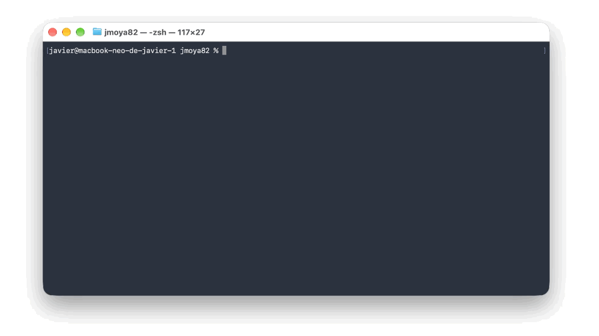

<p align="right">
<a href="https://oreol.ch">Oreol</a> <a href="https://oreolag.github.io/docs/mgmt/">Manual</a> <a href="https://github.com/oreolag/ansible-collection">Ansible Collection</a>
</p>

<!-- <p align="center" style="margin-bottom: 0px;">
  
</p> -->

<h1 align="center">
  Oreol Management
  <p align="center">
    <a href="https://github.com/oreolag/mgmt/releases"></a>
    <a href="https://github.com/oreolag/mgmt/blob/main/LICENSE"></a>
    <a href="https://github.com/oreolag/mgmt/graphs/contributors"></a>
    <a href="https://github.com/oreolag/mgmt/stargazers"></a>
  </p>
</h1>

<!-- docs:mgmt_readme_intro:start -->
Oreol Management, or `omgmt`, is a command-line toolkit that helps you set up, configure, and maintain your Oreol cluster from your terminal or scripts.

Built on the [Oreol Ansible Collection,](https://github.com/oreolag/ansible-collection) it brings together your inventory, variables, and configuration management database (CMDB).

For Oreol-managed clusters, Oreol provides a customized `omgmt` repository for co-managing your infrastructure under your management agreement. For independently managed clusters and remote servers, follow the installation instructions below to get started.
<!-- docs:mgmt_readme_intro:end -->

<!-- docs:mgmt_readme_installation:start -->
## Installation
Run the following command from the directory where you want to keep `my_oreol_mgmt` (see [Supported Platforms](#supported-platforms)):

```bash
curl -H 'Cache-Control: no-cache' -fsSL https://oreol.ch/mgmt/install.sh | sudo bash
```

The installer creates the `my_oreol_mgmt` repository in your GitHub account if it does not exist, or clones the existing repository. It stores the local checkout in `./my_oreol_mgmt` and saves its path so you can run `omgmt` from any directory. If needed, run `gh auth login` first.
<!-- docs:mgmt_readme_installation:end -->

<!-- docs:mgmt_readme_supported_platforms:start -->
## Supported Platforms
`omgmt` currently supports macOS and the following Ubuntu-based Linux distributions:

- Ubuntu
- NVIDIA DGX

Additional Linux distributions may work but are not officially validated yet.
<!-- docs:mgmt_readme_supported_platforms:end -->

<!-- docs:mgmt_readme_supported_how_it_works:start -->
## How it Works
`omgmt` combines the [Oreol Ansible Collection](https://github.com/oreolag/ansible-collection) with your cluster’s inventory and configuration to run management playbooks across your infrastructure. You can extend it with your own playbooks to meet your cluster’s needs. For clusters running [Oreol CLI,](https://github.com/oreolag/cli) `omgmt` also manages its installation and configuration, complementing the CLI with centralized administration. Click [here](https://oreolag.github.io/docs/mgmt/how-it-works/) to learn more.

## Examples

### Installing `odev`
Once you have defined your cluster and configured its inventory, install `odev` on all hosts with:

```bash
omgmt run playbook --name odev_install --cluster tailnet_de_javier --hosts all
```

### Infrastructure Management
Run management playbooks on selected hosts. For example, mount the configured storage on your development servers:

```bash
omgmt run playbook --name odev_storage_mount --cluster tailnet_de_javier --hosts odev_development_servers
```
<!-- docs:mgmt_readme_supported_how_it_works:end -->



## Citation

[](https://doi.org/10.5281/zenodo.24560295)
[](https://doi.org/10.1145/3805700)

<!-- docs:mgmt_readme_supported_citation:start -->
If you use `omgmt` in your research, development, or publications, please cite the following references:

```bibtex
@misc{moya2026omgmt,
  author       = {Javier Moya},
  title        = {oreolag/mgmt: omgmt},
  howpublished = {Zenodo},
  year         = {2026},
  note         = {\url{https://doi.org/10.5281/zenodo.24560295}},
  doi          = {10.5281/zenodo.24560295}
}
```

```bibtex
@article{moya2026hacc,
  author    = {Javier Moya and Matthias Gabathuler and Mario Ruiz and Gustavo Alonso},
  title     = {A Development Platform for Managed Heterogeneous Accelerated Compute Clusters: A Case Study on ETH Zurich’s AMD HACC},
  journal   = {ACM Transactions on Reconfigurable Technology and Systems},
  year      = {2026},
  doi       = {10.1145/3805700},
  url       = {https://doi.org/10.1145/3805700}
}
```
<!-- docs:mgmt_readme_supported_citation:end -->