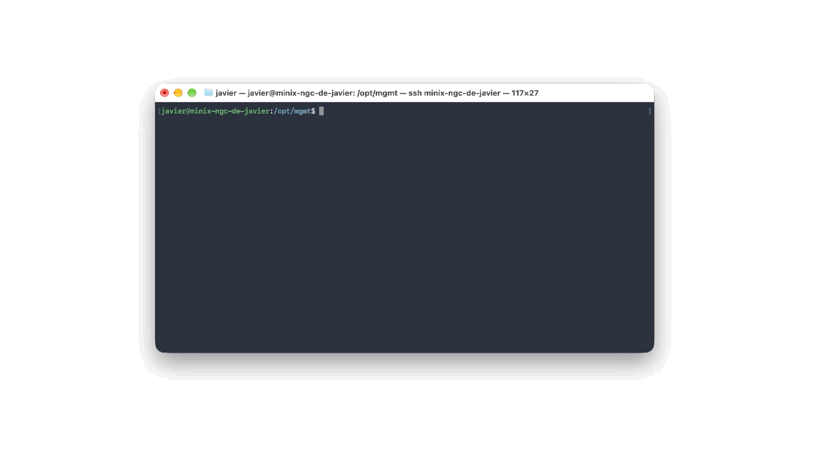

<p align="right">
<a href="https://oreol.ch">Oreol</a> <a href="https://oreolag.github.io/docs/mgmt/">Manual</a> <a href="https://github.com/oreolag/ansible-collection">Ansible Collection</a>
</p>

<!-- <p align="center" style="margin-bottom: 0px;">
  
</p> -->

<h1 align="center">
  Oreol Management
  <p align="center">
    <a href="https://github.com/oreolag/mgmt/releases"></a>
    <a href="https://github.com/oreolag/mgmt/blob/main/LICENSE"></a>
    <a href="https://github.com/oreolag/mgmt/graphs/contributors"></a>
    <a href="https://github.com/oreolag/mgmt/stargazers"></a>
  </p>
</h1>

`omgmt` simplifies software installation and low-level system configuration across your Oreol clusters and remote servers. Built on the [Oreol Ansible Collection,](https://github.com/oreolag/ansible-collection) it brings together your inventory, variables, and configuration management database (CMDB).

For Oreol-managed clusters, Oreol provides a customized `omgmt` repository for co-managing your infrastructure under your management agreement. For independently managed clusters and remote servers, follow the installation instructions below to get started.

## Installation
Run the following command from the directory where you want to keep `my_oreol_mgmt` (see [Supported Platforms](#supported-platforms)):

```bash
curl -H 'Cache-Control: no-cache' -fsSL https://oreol.ch/mgmt/install.sh | sudo bash
```

The installer checks out your GitHub repository in `./my_oreol_mgmt` and saves its path so you can run `omgmt` from any directory. If needed, run `gh auth login` first.

## Supported Platforms
`omgmt` currently supports macOS and the following Ubuntu-based Linux distributions:

- Ubuntu
- NVIDIA DGX

Additional Linux distributions may work but are not officially validated yet.

### How it Works
Oreol Management, or `omgmt`, combines the Oreol Ansible Collection with your cluster’s inventory and configuration to run management playbooks across your infrastructure. You can extend it with your own playbooks to meet your cluster’s needs. For clusters running [Oreol CLI,](https://github.com/oreolag/cli) `omgmt` also manages its installation and configuration, complementing the CLI with centralized administration.

<!--  -->

## Citation

[](https://doi.org/10.1145/3805700)

If you use `omgmt` in your research, development, or publications, please cite the following reference:

```bibtex
@article{moya2026hacc,
  author    = {Javier Moya and Matthias Gabathuler and Mario Ruiz and Gustavo Alonso},
  title     = {A Development Platform for Managed Heterogeneous Accelerated Compute Clusters: A Case Study on ETH Zurich’s AMD HACC},
  journal   = {ACM Transactions on Reconfigurable Technology and Systems},
  year      = {2026},
  doi       = {10.1145/3805700},
  url       = {https://doi.org/10.1145/3805700}
}
```
